# SotuHire — Copiloto de Carreira Local-First com IA, Evidências e Aprovação Humana

[](https://github.com/Soturine/SotuHire/actions/workflows/ci.yml)
[](https://soturine.github.io/SotuHire/)
[](https://github.com/Soturine/SotuHire/releases/latest)
[](https://www.python.org/)
[](LICENSE)

O SotuHire ajuda estudantes e profissionais de diferentes áreas a compreender o estado da própria
carreira, organizar evidências e decidir a próxima ação. Ele conecta perfil, currículo, portfólio,
trajetória acadêmica, oportunidades, candidaturas, entrevistas e outcomes sem entregar decisões
importantes a uma automação opaca. Tudo roda na sua máquina.

**O diferencial:** o Copilot pode observar, explicar, planejar e propor. Alterações importantes
seguem sempre **prévia → evidências → impacto → aprovação humana → execução local → audit → undo**.
Você informa um fato uma vez no Perfil; ele chega ao Currículo Mestre, às variantes e ao Application
Lab sem redigitação e sem virar verdade antes da sua confirmação.

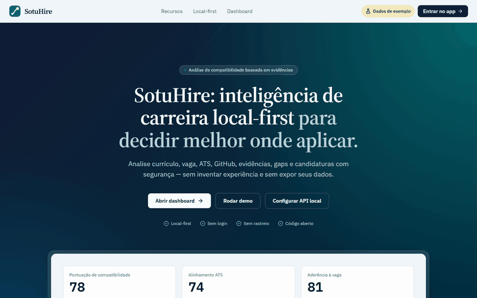

<sub>Capturado do build de produção em modo de exemplo (persona fictícia). Versão em vídeo:
[sotuhire-demo.webm](docs/assets/demo/sotuhire-demo.webm).</sub>

## Destaques de engenharia

- Evidence Graph tipado em SQLite, com proveniência, revisão independente de nós/edges e stale.
- Career State e Next Best Actions determinísticos; IA explica e redige, mas não controla regras.
- Human-Approved Copilot com planos persistentes, preview, impacto, aprovação, idempotência, audit e undo.
- Perfil Universal → Currículo Mestre → variantes, com reconciliação de fatos alterados e controle de concorrência (uma cópia antiga nunca sobrescreve uma mais nova).
- Arquitetura local-first e privacy-first, com contexto mínimo e providers externos opt-in.
- Frontend React/TypeScript, API FastAPI/Pydantic e extensão Chrome MV3 que funciona sozinha ou ligada ao Local Companion.
- Qualidade automatizada: Ruff, Pyright, pytest, Vitest, Playwright (Chromium no CI; Firefox e WebKit sob demanda), teste de contrato cliente × API, DAST da API local, mutação de UI, CodeQL e SBOM verificado.

## Stack

| Camada | Tecnologias |
| --- | --- |
| Frontend | React 19, TypeScript, Vite, Tailwind CSS 4, TanStack Router e Query |
| Backend | Python 3.11+, FastAPI, Pydantic |
| Dados | SQLite (schema 8), migrations com verificação, snapshots imutáveis e audit |
| IA | Local determinístico, Anthropic (Claude), Gemini, OpenAI, Ollama, LM Studio e endpoints compatíveis |
| Browser | Extensão Chrome MV3 e Local Companion |
| QA | pytest, Vitest, Playwright, Ruff, Pyright |
| Segurança/release | GitHub Actions, CodeQL, secret scan, DAST local e CycloneDX SBOM |

## Identidade visual

A interface 2.1 usa uma identidade própria: barra lateral marinho escuro, superfícies em camadas,
gradiente reservado ao destaque de cada tela, títulos serifados e números em fonte tabular. A
navegação segue jornadas (Hoje, Quem eu sou, Currículos, Oportunidades, Candidaturas), com busca
global, tema claro/escuro, pt-BR/en-US e versão mobile com barra inferior. As decisões estão no
[ADR 006](docs/02-architecture/adrs/006-journey-navigation-and-editorial-design-system.md) e nas
[notas do design system](docs/08-frontend/design-system-notes.md).

## Por que existe

Ferramentas isoladas não respondem “onde estou?”, “o que está faltando?” ou “por que devo fazer
isso agora?”. O SotuHire cria continuidade entre dados confirmados e decisões. Inferências ficam
na [Caixa de Evidências](docs/05-user-guide/career-workflow.md#evidence-inbox); fatos confirmados formam o
[Evidence Graph](docs/02-architecture/evidence-graph.md); regras determinísticas produzem o
[Career State](docs/02-architecture/human-approved-copilot.md#career-state); o
[Copilot](docs/02-architecture/human-approved-copilot.md) transforma recomendações em propostas
individuais e reversíveis.

Serve a software, engenharia, saúde, direito, pesquisa, educação, design, artes, administração,
serviços, carreiras técnicas, concursos, início ou transição de carreira. GitHub é uma fonte útil
quando aplicável — nunca o centro obrigatório do produto.

## A jornada em cinco minutos

1. Inicie API e frontend e escolha idioma/tema.
2. Crie ou importe o perfil; nenhuma extração vira fato automaticamente.
3. Revise a Caixa de Evidências e confirme somente o que é verdadeiro.
4. Monte o Currículo Mestre a partir do Perfil e derive variantes por vaga no Resume Studio.
5. Abra o Career Cockpit para prioridades, gaps, entrevistas e candidaturas.
6. Abra o Copilot, examine razão/evidências/impacto e crie uma proposta.
7. Aprove individualmente, execute localmente e use undo quando oferecido.

## Capacidades principais

| Área | O que entrega | Boundary |
| --- | --- | --- |
| Career Cockpit | estado, prioridades e saúde de dados/IA | sem score mágico único |
| Perfil Universal | fatos com origem, confiança e confirmação; importação de texto, Lattes e JSON Resume | inferência não vira fato |
| Resume Studio | Currículo Mestre, variantes versionadas, preview ATS-safe, PDF/DOCX/JSON Resume | substituir o Mestre exige confirmação |
| Evidence Graph | nós e relações tipadas com origem, review e stale | inferência não vira fato |
| Portfólio | software, pesquisa, ensino, design, hardware, arte e mais | IA gera rascunho revisável |
| Radar e Fontes | vagas e editais de fontes oficiais e capturas assistidas | sem crawling em massa |
| Tracker | funil, quadro por etapas e lista, com busca sem acento | candidatura sempre manual |
| Next Best Actions | regras determinísticas e explicáveis | sem alterar pesos por outcome |
| Approval Queue | before/after, impacto, risco, evidence refs e undo | sem “Aprovar tudo” |
| Copilot | contexto mínimo, planos e tools allowlisted | writes viram propostas |
| Busca universal | telas, evidências, portfólio, Perfil e candidaturas | SQLite/API local, sem ElasticSearch |
| Application Lab | Match, ATS, sugestões revisáveis, variante, kit e Tracker | afirmação sem evidência não é aceita |
| Providers | local, Anthropic, Gemini, OpenAI, Ollama, LM Studio e compatíveis | opt-in e fallback explícito |

## Como tudo se conecta

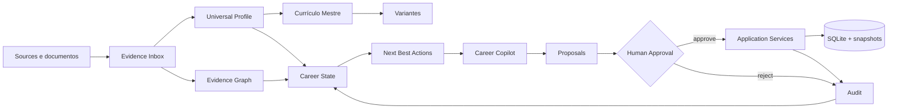

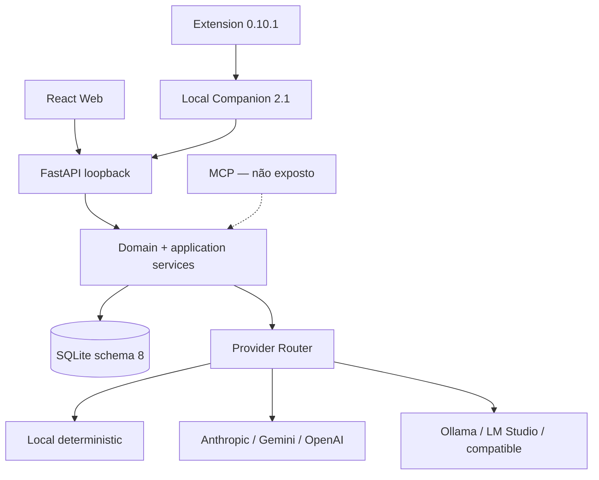

Detalhes: [arquitetura](docs/02-architecture/data-flow.md),
[Copilot e tool registry](docs/02-architecture/human-approved-copilot.md),
[segurança](docs/06-engineering/v2-security-threat-model.md) e
[privacidade do contexto](docs/04-ai/copilot-context-and-privacy.md).

## Screenshots

Capturas do build de produção 2.1 em modo de exemplo (dados fictícios).

| Career Cockpit | Copilot contextual |
| --- | --- |
| 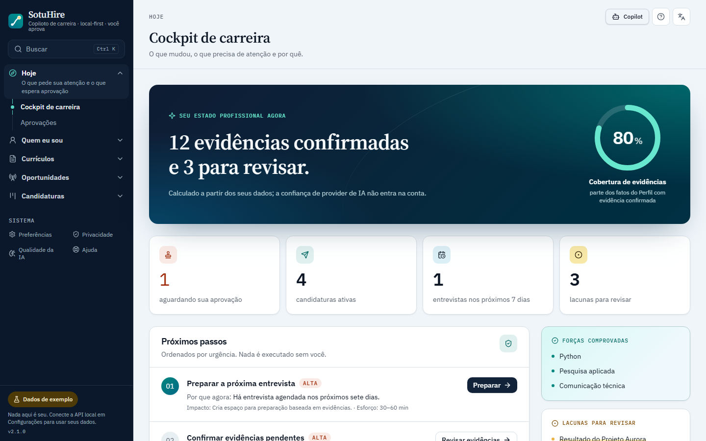 | 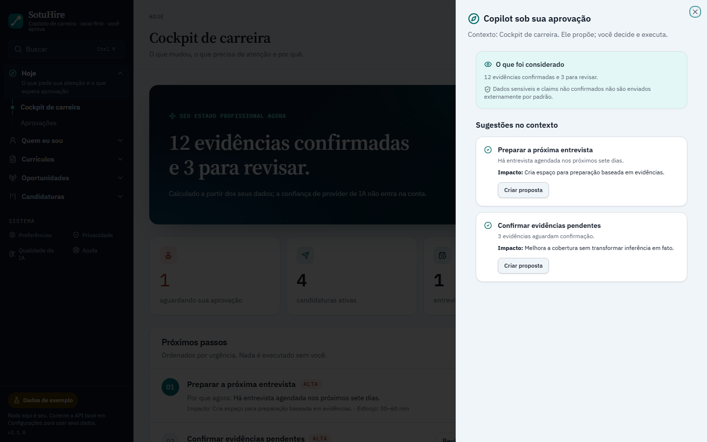 |

| Perfil Universal | Resume Studio |
| --- | --- |
| 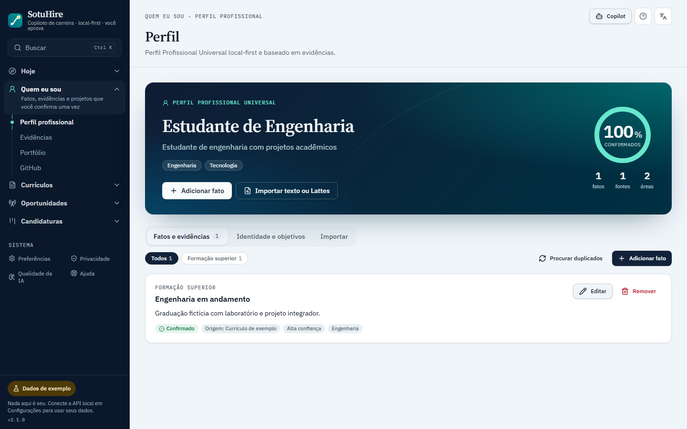 | 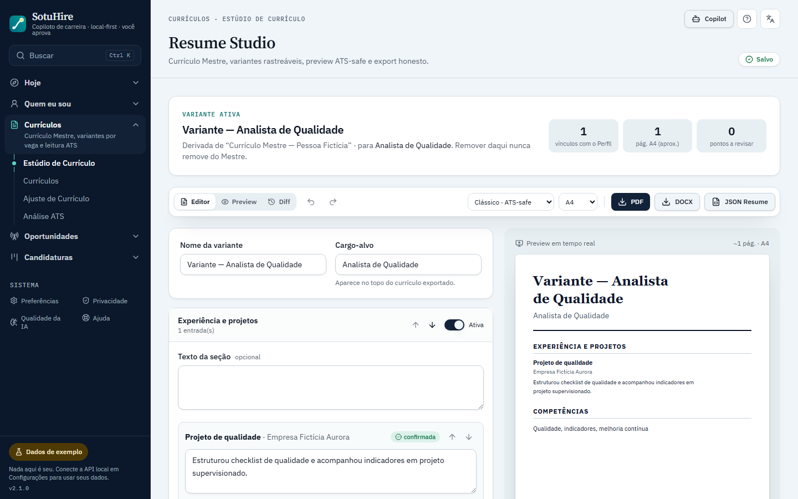 |

| Radar | Tracker |
| --- | --- |
| 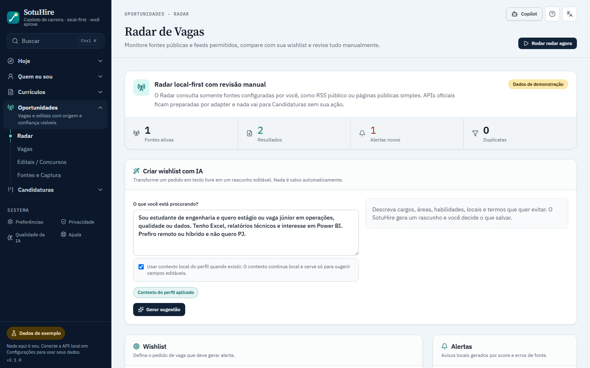 | 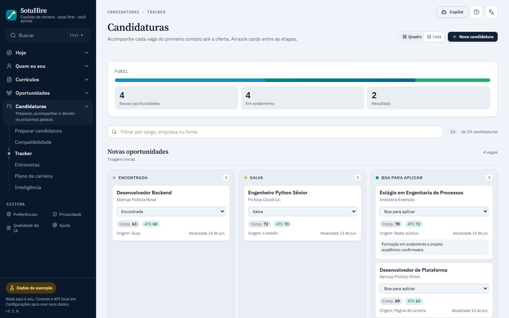 |

| Application Lab | Aprovações |
| --- | --- |
| 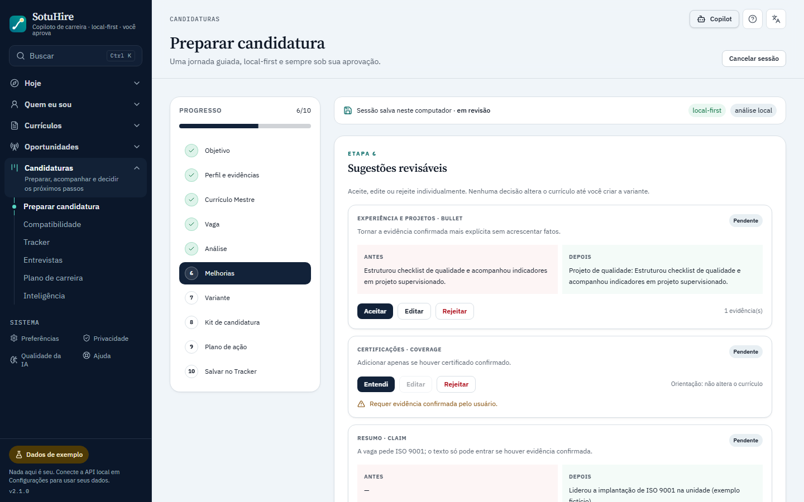 | 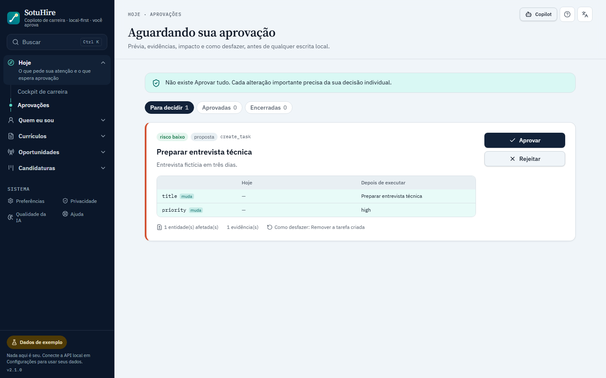 |

| Tema escuro | Mobile |
| --- | --- |
| 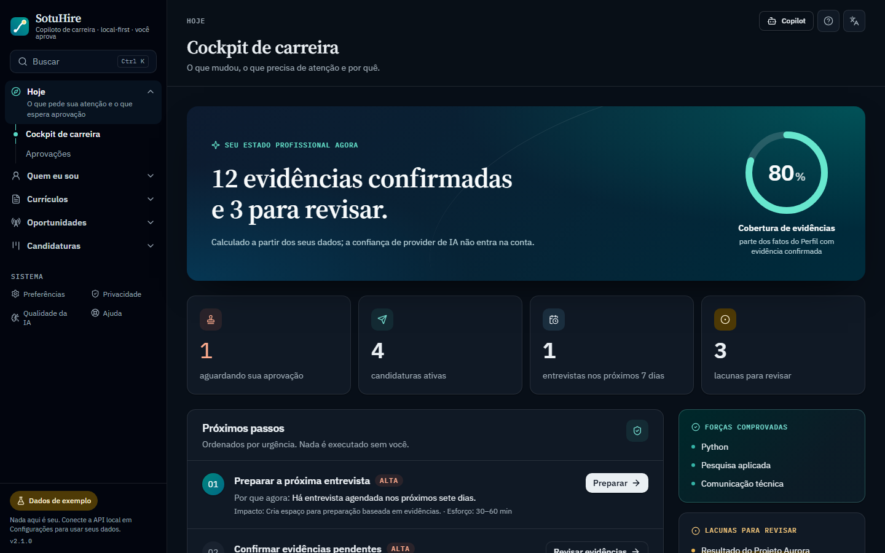 | 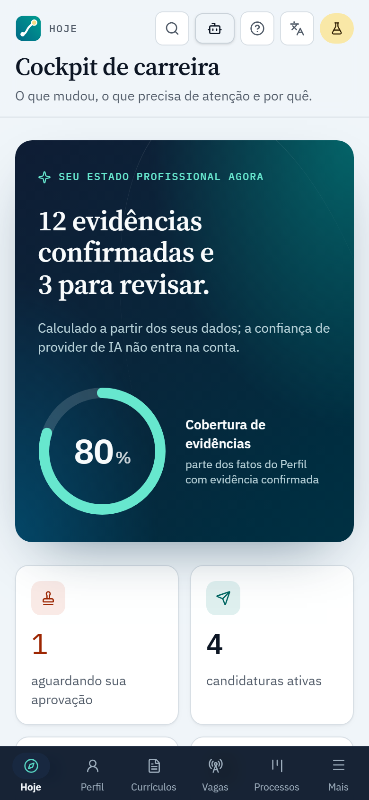 |

### Extensão Chrome

A extensão trabalha sobre a página que a pessoa abriu: captura vagas e editais sob ação explícita,
prepara oportunidades para o Application Lab, envia itens ao Tracker e analisa repositórios públicos
do GitHub, sem automatizar candidatura, login ou navegação.

| Modo | Precisa de | O que funciona |
| --- | --- | --- |
| Independente | nada (nem chave de IA) | captura e cópia, análise determinística de GitHub, botão **SotuHire Insight**, fila offline para ações conectadas |
| Com Local Companion | `python -m modules.local_api.server` | pareamento por sessão, captura com snapshot e deduplicação, Match/ATS, Tracker, editais, entrega da fila offline |
| Integrado | Companion + API + web | **Preparar candidatura** abre o Application Lab só com identificadores; a vaga aparece no Tracker do site |

Os três modos são exercitados no pacote distribuível, num Chromium real, por
`scripts/verify_extension_modes.py`. Chaves próprias Gemini/OpenAI ficam no service worker e só
vão ao próprio provider.

| Modo independente | Análise pública de GitHub |
| --- | --- |
| 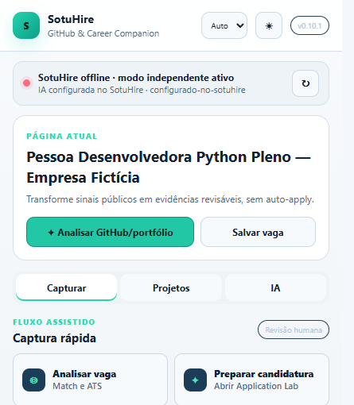 | 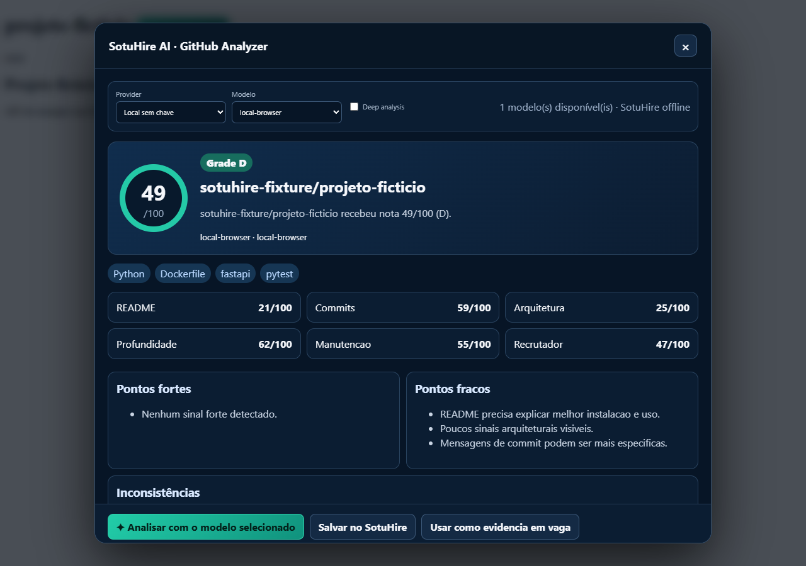 |

Veja o [guia completo da extensão](browser-extension/README.md) para providers, armazenamento de
chaves, fila offline, permissões, editais e limites de segurança. Roteiro de demonstração:
[demo de 3–5 minutos](docs/09-portfolio/demo-script.md).

## Instalação

Requisitos: Python 3.11/3.12, Node.js 22+, npm e Git.

```bash
git clone https://github.com/Soturine/SotuHire.git
cd SotuHire
python -m venv .venv
```

### Windows PowerShell

```powershell
.\.venv\Scripts\Activate.ps1
python -m pip install --upgrade pip
pip install -e .[dev]
cd apps/web
npm ci
cd ../..
```

### Linux e macOS

```bash
source .venv/bin/activate
python -m pip install --upgrade pip
pip install -e ".[dev]"
cd apps/web && npm ci && cd ../..
```

`dev` traz testes, lint, docs e a interface Streamlit legada. Fora dele a instalação padrão
(`pip install -e .`) só tem API e núcleo; extras opcionais: `ai` (SDKs Gemini e Anthropic), `browser`
(captura assistida via Playwright/CDP), `legacy-ui` (Streamlit) e `docs` (MkDocs).

### Primeiros passos

Em dois terminais:

```bash
python scripts/run_api.py
```

```bash
cd apps/web
npm run dev
```

Abra o endereço que `run_api.py` imprime (`http://localhost:5173/#sotuhire-pairing=…`): ele pareia
o navegador com a API local. Sem a API, o site abre em **modo de exemplo**, com uma persona
fictícia, para conhecer as telas. A API permanece em loopback; os contratos v1 continuam em
`/api/v1` e o núcleo Copilot/Evidence usa `/api/v2`. No Windows, `.\start-sotuhire.ps1` sobe tudo.

Companion e extensão: `python -m modules.local_api.server` e depois carregue
`browser-extension/` em `chrome://extensions` (modo do desenvolvedor). O pacote pronto
`sotuhire-extension-v0.10.1.zip` acompanha cada [release](https://github.com/Soturine/SotuHire/releases/latest).

## IA e providers

O produto funciona sem IA externa. Em **Configurações → IA**, escolha:

- **Local deterministic:** estado, ranking e regras sem modelo;
- **Anthropic (Claude), Gemini ou OpenAI:** somente com chave no backend e opt-in;
- **Ollama/LM Studio/OpenAI-compatible:** endpoint loopback por padrão.

Antes de compartilhar contexto externo, o SotuHire informa purpose, quantidade de itens, estimativa
de tokens e itens sensíveis omitidos. Registro profissional é sensível e não sai por padrão.
Veja [providers](docs/04-ai/provider-strategy.md) e [context budget](docs/04-ai/copilot-context-and-privacy.md).

## Privacidade e segurança

Dados estruturados usam SQLite. JSON/JSONL permanece apenas para compatibilidade, fixtures e
export onde necessário. Conteúdo de vagas, PDF, README, RSS, portfólio e web é não confiável e não
pode escolher tools, alterar system instructions ou contornar aprovação. A API local recusa Host
forjado, origens estranhas e requisições sem sessão, e não lê corpos antes de autenticar.

### O que o SotuHire NÃO faz

- auto-apply, candidatura ou inscrição em massa;
- login, CAPTCHA bypass ou captura de cookie/sessão/senha/token;
- envio automático de currículo, e-mail ou resposta a recrutador;
- pagamento ou submissão de formulário;
- alteração silenciosa do perfil ou do Currículo Mestre;
- invenção de experiência, skill, formação, publicação, registro ou resultado.

### Limitações conhecidas

- As telas de produto estão em pt-BR; shell, busca, Cockpit, Copilot e Aprovações também em en-US.
- Chamadas reais aos providers externos dependem da sua chave; os testes usam fixtures.
- A extensão é validada em Chromium; não está publicada na Chrome Web Store.

Threat model: [Copilot, tools, anexos, busca e prompt injection](docs/06-engineering/v2-security-threat-model.md).

## Migração e recuperação

Schema 6 ou 7 pode avançar explicitamente ao schema 8, com backup, dry-run e verify:

```bash
python scripts/migrate_local_data.py --dry-run
python scripts/migrate_local_data.py --apply
python scripts/migrate_local_data.py --verify
python scripts/check_data_health.py
```

Arquivos legados não são apagados; backups nunca se sobrescrevem e a restauração pela interface
exige confirmação. Leia o [guia de migração](docs/06-engineering/v2-migration-and-recovery.md).

## Desenvolvimento, testes e documentação

```bash
ruff check .
ruff format --check .
pyright
pytest
mkdocs build --strict
cd apps/web
npm run test:unit
npm run lint
npm run typecheck
npm run build
npm run test:e2e
```

Verificações de ponta a ponta: `python scripts/verify_extension_modes.py --out report.json`
(extensão nos três modos), `python scripts/dast_local_api.py --bootstrap <x>` (API em diretório
descartável) e `python scripts/capture_readme_media.py` (refaz as capturas e o GIF deste README).

- [Documentação publicada](https://soturine.github.io/SotuHire/)
- [Índice completo da documentação](docs/documentation-index.md)
- [Visão do produto](docs/01-product/v2-product-vision.md)
- [Evidence Graph](docs/02-architecture/evidence-graph.md)
- [Human-Approved Copilot](docs/02-architecture/human-approved-copilot.md)
- [Guia da jornada e aprovações](docs/05-user-guide/career-workflow.md)
- [Frontend](docs/02-architecture/frontend-v2.md)
- [Application Lab](docs/02-architecture/application-lab.md)
- [Roadmap](docs/01-product/roadmap.md)
- [Release v2.1.0](docs/releases/v2.1.md) · [v2.0](docs/releases/v2.0.md)
- [Histórico de mudanças](CHANGELOG.md)

## Próximos passos

O roadmap não promete uma versão arbitrária. Próximos investimentos dependem de feedback real e
estão nas [issues](https://github.com/Soturine/SotuHire/issues): retirada gradual do armazenamento
legado, tradução completa das telas de produto, qualidade de recomendações com amostra (`n`),
acessibilidade com leitor de tela e possível MCP local somente após validar transporte, token e scopes.

## Licença

[Apache License 2.0](LICENSE). Contribuições seguem [CONTRIBUTING.md](CONTRIBUTING.md).
