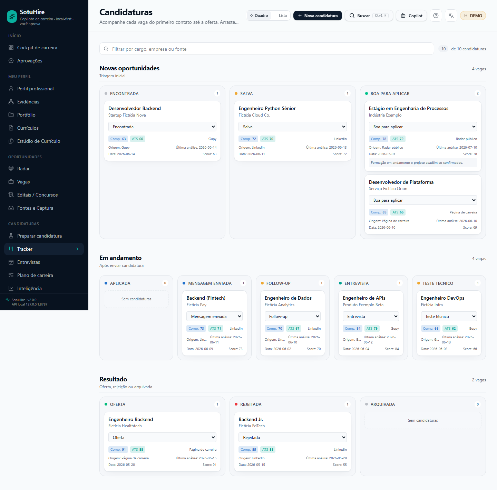
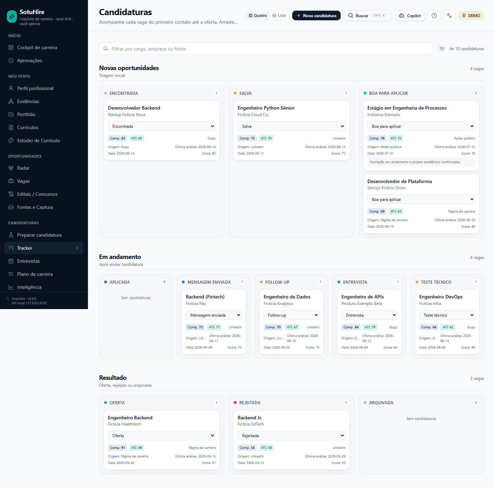
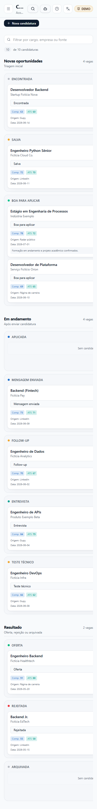
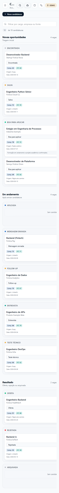
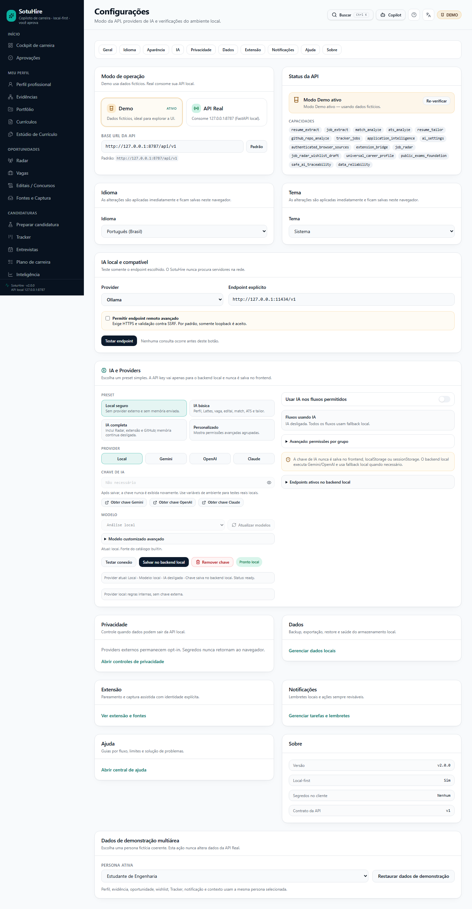
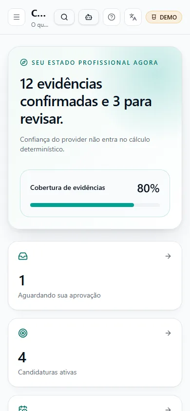
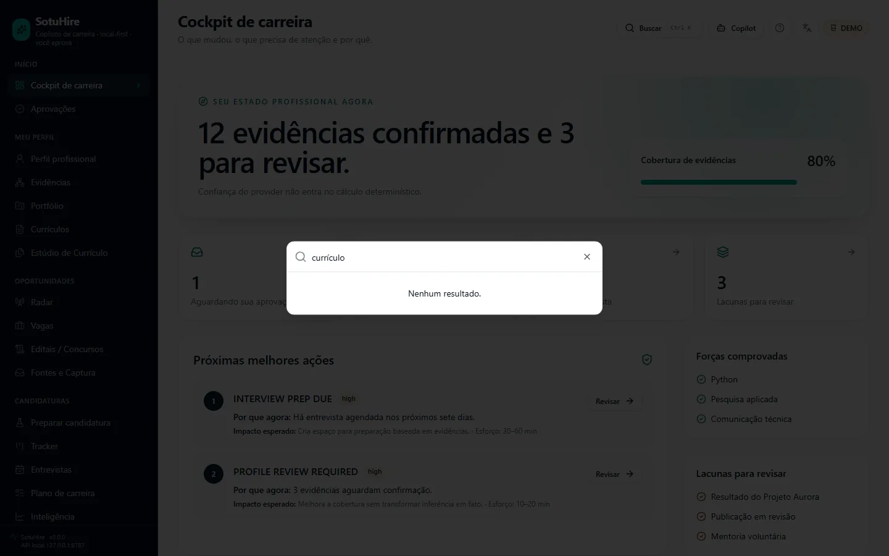
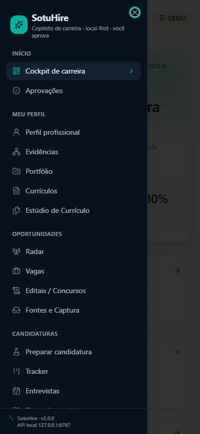

# Frontend: acessibilidade, continuidade de dados e evidência antes/depois — 2026-11

Parte da [auditoria de 2026-11](2026-11-independent-assurance-audit.md) (CP-FE00, CP-FE01a e, a partir
do adendo v5, o redesign CP-UX00…06). A seção [Redesign 2026-11 v5](#redesign-2026-11-v5) tem a baseline
nova e a galeria antes/depois do redesign; as seções anteriores são o registro histórico da correção
de acessibilidade e não provam o redesign.

## Método

`apps/web/tests/e2e/ux-baseline.spec.ts` (só com `CAPTURE_UX=1`) captura 22 rotas em 1440×900 e 390×844,
tema claro, `prefers-reduced-motion`, pt-BR, dados demo fictícios, Chromium. Para cada tela grava a
captura de página inteira e um registro com estouro horizontal, violações do axe-core 4.14 (regras
WCAG 2.0/2.1/2.2 A e AA) por impacto, com elementos e cores, e erros de console. O mesmo arquivo gera o
antes e o depois.

- Antes: `8b9e82a`. Depois: o commit deste checkpoint.
- Hash SHA-256 do conjunto de registros JSON antes+depois (fora do repositório):
  `87654ed8261ab6a99406c0697ee8d53a229de1a00c64b54b4585cee5df6d1c0a`.
- axe automatizado não é certificação WCAG; leitor de tela e teste com pessoas continuam pendentes.

## Resultado (22 rotas × 2 viewports)

| Medida | Antes | Depois |
| --- | --- | --- |
| Nós com violação crítica | 20 (12 `select-name`, 8 `label`) | 0 |
| Nós com violação séria | 309 (288 `color-contrast`, 21 `label-content-name-mismatch`) | 0 |
| Telas com estouro horizontal a 390 px | 0 | 0 |
| Telas com erro de console | 0 | 0 |

## Causas e correções

| Causa | Correção |
| --- | --- |
| As cores semânticas de preenchimento (`accent`, `success`, `warning`, `destructive`) eram usadas também como cor de texto, inclusive sobre o próprio tom a 15%: contraste de 1,8 a 3,3:1 | Tokens de texto `--*-strong` para claro e escuro, calculados em OKLCH com mistura em sRGB codificado (o modelo reproduz exatamente a medição do axe, `#5e6770` sobre `#08121f` = 3,26:1): ≥ 5,2:1 sobre cartão, fundo e tons de 15–20%. 199 usos migrados de `text-X` para `text-X-strong`; os preenchimentos continuam para fundo, borda e ícone. |
| Rótulos de seção da barra lateral a 40% de opacidade (3,26:1) | 65% (6,7:1) |
| Busca universal com `aria-label` diferente do texto visível (WCAG 2.5.3) | o nome acessível é o texto visível "Buscar"; atalho em `aria-keyshortcuts` |
| 10 campos sem nome acessível em Perfil, Radar, Configurações e Fontes; dois `<label>` visíveis não associados ao campo | `htmlFor`/`id` onde havia rótulo; `aria-label` com o propósito nos demais |
| Selos do Tracker com texto `chart-1` e rótulos a 70% de opacidade | texto em `foreground`, hierarquia por peso |

Fora da contagem: um botão de Configurações apareceu desativado durante a captura (estado transitório
"verificando").

## Continuidade de dados na interface

Ver o [mapa de autoridade](2026-11-data-authority-map.md). No Resume Studio: tela de primeiro uso em vez
de erro, criação do Currículo Mestre a partir do Perfil, painel de fatos novos do Perfil com escolha
explícita, e rascunho local que não sobrescreve conteúdo mais novo.

## Antes e depois

| Tela | Antes | Depois |
| --- | --- | --- |
| Cockpit, desktop |  |  |
| Tracker, desktop |  |  |
| Tracker, mobile |  |  |
| Configurações, desktop |  |  |
| Perfil, mobile |  |  |

As demais 34 capturas de cada lado ficam fora do repositório (hash acima).

## Decisões de stack nesta fase

| Peça | Decisão | Motivo |
| --- | --- | --- |
| React, TanStack Router/Query, Vite, Tailwind, Radix | KEEP | os problemas medidos eram de tokens, rótulos e fluxo de dados, não de framework |
| `@axe-core/playwright` 4.14.0 (MPL-2.0) | ADD, só dev | medida objetiva de acessibilidade; não vai para o pacote |
| Biblioteca de animação | NOT_ADDED | `tw-animate-css` e CSS bastam até haver uma interação que justifique; `prefers-reduced-motion` é respeitado na captura |
| zod 3 → 4 | DEFER | advisory alto ainda aberto (ver [dependências](2026-11-dependency-review.md)); migração exige formulários e resolvers testados |

## Próximo

Redesign visual (identidade, tipografia, densidade, navegação por jornada) em fatias verticais com o
mesmo antes/depois; componente `Field` para associar rótulo e campo de forma sistemática (48 rótulos
sem `htmlFor` não acusados pelo axe porque o campo tem outro nome); verificação com leitor de tela.

## Redesign 2026-11 v5

Direção, alternativas e plano: [design-direction-2026-11](../08-frontend/design-direction-2026-11.md).
Decisão de arquitetura: [ADR 006](../02-architecture/adrs/006-journey-navigation-and-editorial-design-system.md).

### Baseline (CP-UX00, app em `459ffa9`)

250 telas (25 rotas × 4 larguras × 2 temas em pt-BR, mais 2 larguras em en-US) e 10 estados
interativos. Gerar de novo:

```bash
cd apps/web
CAPTURE_UX=1 CAPTURE_UX_DIR=<pasta>/before CAPTURE_UX_VIEWPORTS=desktop,tablet,mobile,small   CAPTURE_UX_THEMES=light,dark npx playwright test tests/e2e/ux-baseline.spec.ts --project=chromium
CAPTURE_UX=1 CAPTURE_UX_DIR=<pasta>/before CAPTURE_UX_VIEWPORTS=desktop,mobile CAPTURE_UX_LOCALES=en-US   npx playwright test tests/e2e/ux-baseline.spec.ts --project=chromium
CAPTURE_UX=1 CAPTURE_UX_DIR=<pasta>/before npx playwright test tests/e2e/ux-states.spec.ts --project=chromium
python scripts/build_ux_gallery.py --before <pasta>/before --before-sha 459ffa9   --out docs/assets/ux-comparison/2026-11-v5
```

| Medida (baseline) | Claro | Escuro |
| --- | --- | --- |
| Nós axe sérios/críticos, por largura | 0 | 28 (`color-contrast`) |
| Telas com estouro horizontal | 0 | 0 |
| Telas com erro de console | 0 | 0 |
| Links de navegação sempre visíveis (desktop) | 23 em 7 grupos | — |
| Resultados da busca para "curriculo", "currículo", "vaga" | 0, 0, 0 | — |

Hash SHA-256 do conjunto de registros JSON da baseline:
`dcde97062ffbe1c095d4008e208cd8215025eb63db149ed11eda508c8fc6abe8`; o `manifest.json` da galeria
tem o hash de cada arquivo. Uma captura de `/portfolio` (mobile, en-US) foi refeita porque o
servidor de desenvolvimento recarregou durante a análise do axe.

| Estado | Antes |
| --- | --- |
| Cockpit, desktop |  |
| Cockpit, mobile |  |
| API local fora do ar |  |
| Busca por "currículo" |  |
| Navegação mobile aberta |  |

As demais imagens da baseline estão na mesma pasta; a coluna "depois" entra a cada checkpoint.
