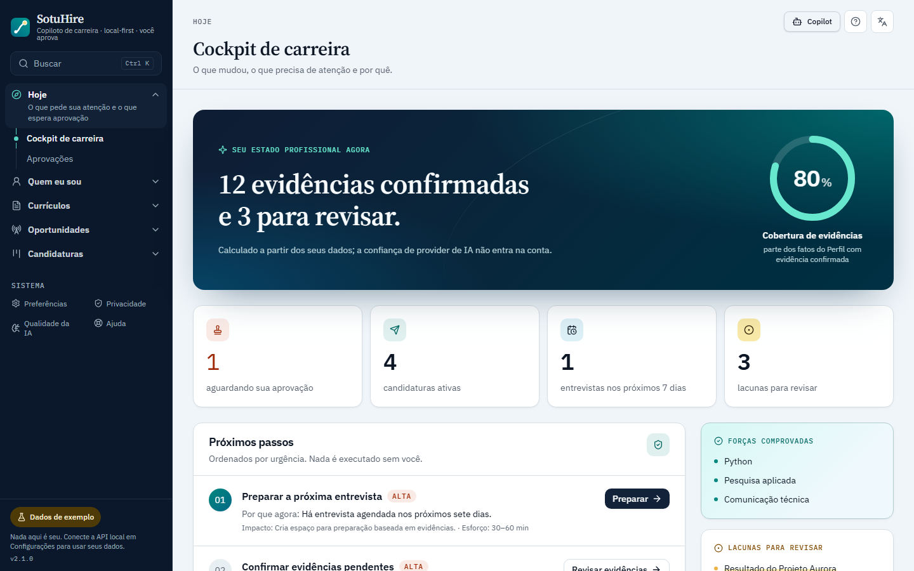
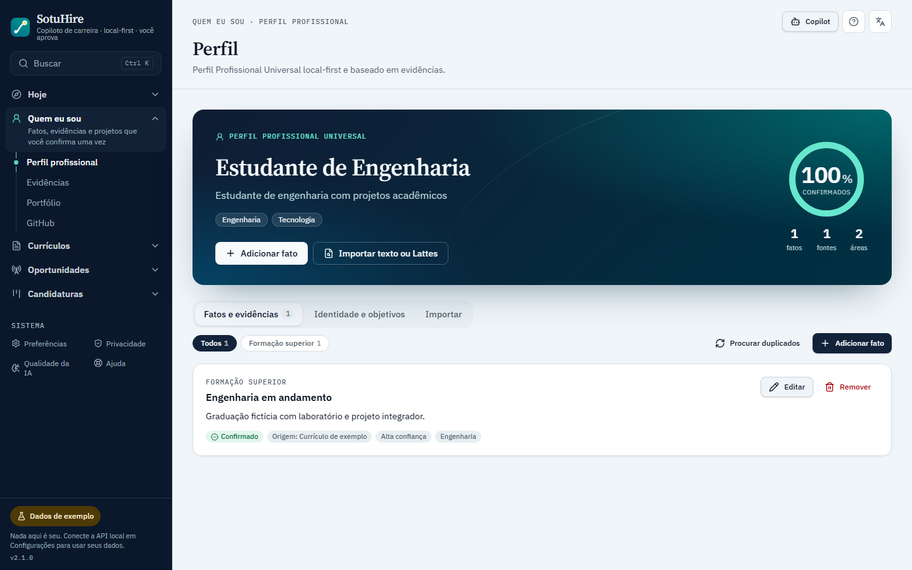
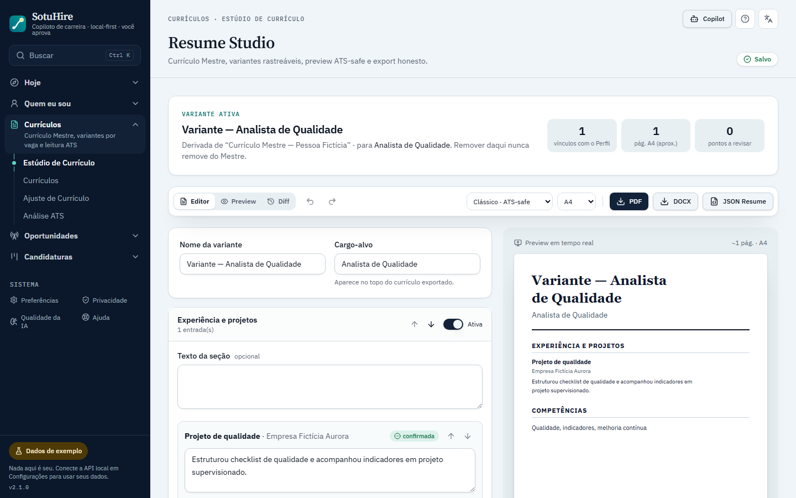
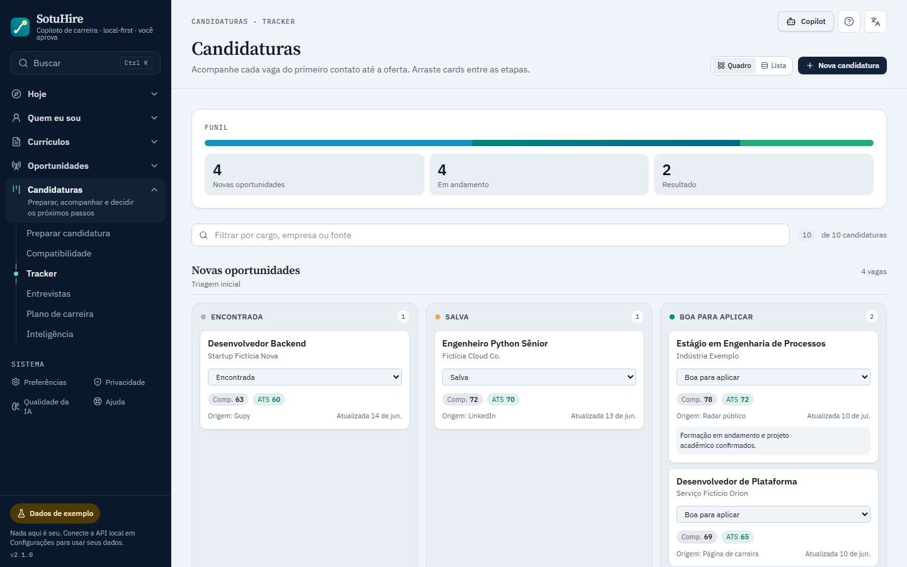
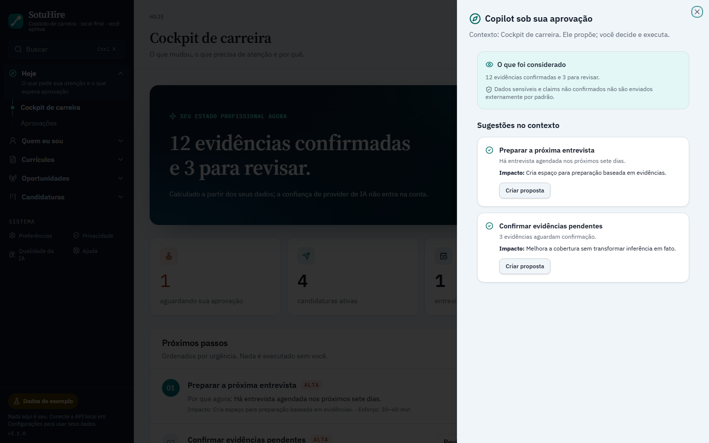
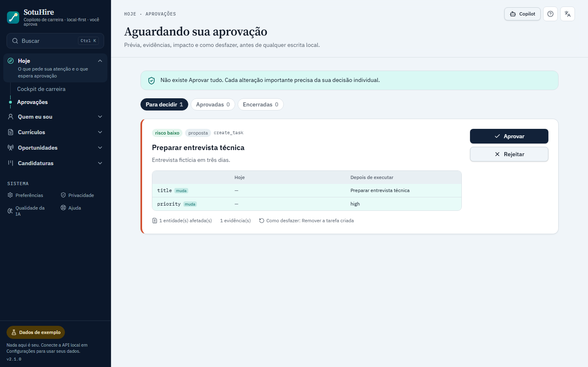
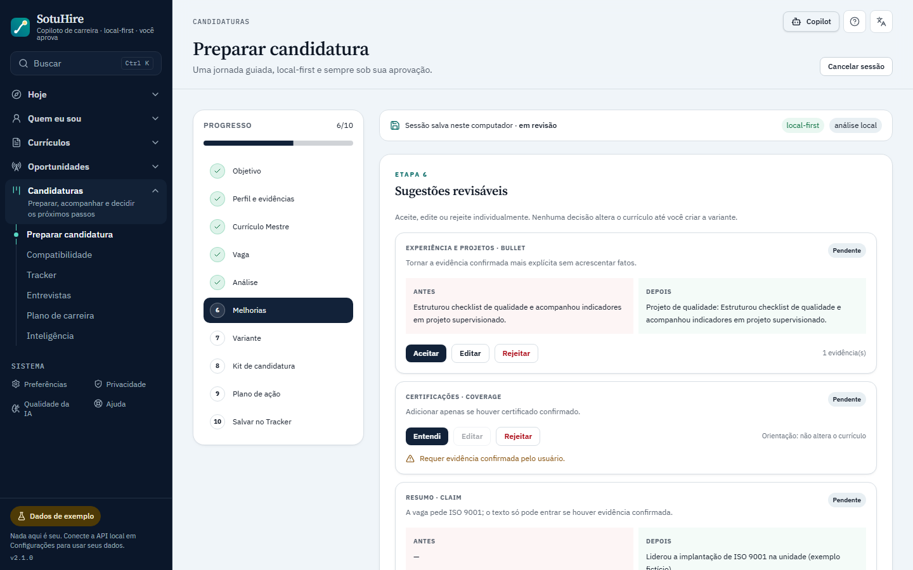

# Demo SotuHire 2.1 — 3 a 5 minutos

Esta demo é para recrutadores, pessoas desenvolvedoras e avaliadores de produto que querem entender
rapidamente como o SotuHire coordena carreira sem transformar IA em autoridade. Use somente a
persona fictícia do **modo de exemplo** (o site abre nele quando a API local não está conectada).

Versão pronta, gravada do build de produção:
[GIF](../assets/demo/sotuhire-demo.gif) · [vídeo WebM](../assets/demo/sotuhire-demo.webm). Para
regravar depois de mudar a interface: `cd apps/web && npx vite build && cd ../..` e
`python scripts/capture_readme_media.py`.

1. **Problema (20s):** perfil, portfólio e candidaturas fragmentados não revelam prioridade nem a
   evidência ausente.
2. **Cockpit (30s):** mostrar estado, cobertura de evidências, candidaturas, entrevistas e próximos
   passos com razão verificável — o cálculo é determinístico.
   
3. **Perfil Universal (35s):** um fato com origem, confiança e confirmação; importar texto produz
   candidatos, não fatos. Proveniência não equivale a verdade.
   
4. **Currículo Mestre e variantes (35s):** o Mestre nasce do Perfil sem redigitação; a variante é
   derivada para uma vaga, com preview ATS-safe e export. Reimportar um currículo pede confirmação
   antes de substituir o Mestre.
   
5. **Radar e Tracker (30s):** oportunidades de fontes oficiais; o funil e o quadro por etapas, com
   busca sem acento. Candidatura sempre manual.
   
6. **Copilot (40s):** abrir o drawer, inspecionar o contexto considerado e criar uma proposta; o
   modelo não escolhe tools nem escreve diretamente.
   
7. **Aprovações (40s):** comparar antes/depois, evidências, impacto e risco; aprovar
   individualmente, executar e mostrar o undo e o histórico.
   
8. **Application Lab e extensão (30s):** a extensão captura uma vaga e abre o Lab só com
   identificadores; sugestões sem evidência confirmada não podem ser aceitas.
   
9. **Segurança e encerramento (20s):** provider opt-in (Anthropic, Gemini, OpenAI ou local), dados
   sensíveis omitidos, conteúdo importado não confiável e MCP não exposto.

As três decisões técnicas memoráveis são: **determinístico antes de IA**, **proposta antes de
escrita** e **SQLite local antes de infraestrutura distribuída**. Nunca mostre chaves, dados pessoais
ou a fixture como resultado de uso real.

Para aprofundar após a demo, use o [case study](portfolio-case-study.md) e a
[arquitetura do Copilot](../02-architecture/human-approved-copilot.md).
