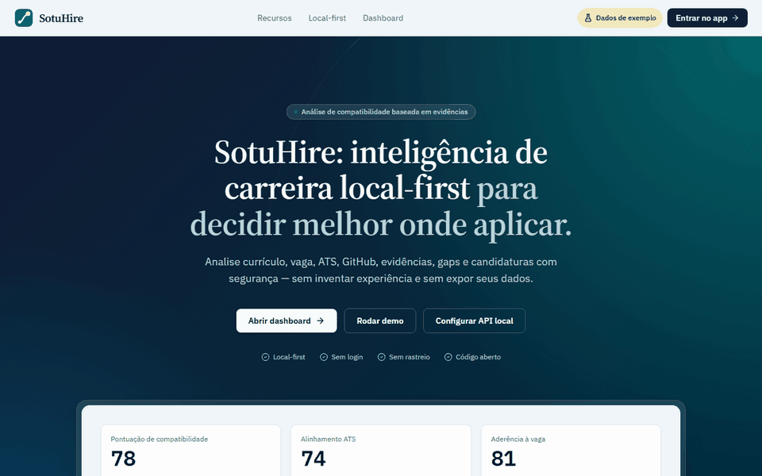

# SotuHire v2.1.0 — Identidade 2.1, Perfil → Currículo Mestre e auditoria de novembro

A 2.1 mantém a arquitetura da 2.0 e muda a experiência: interface redesenhada por jornadas, dados
informados uma vez no Perfil chegando ao Currículo Mestre e às variantes, e o resultado de uma
auditoria independente com correções de segurança, dados e confiabilidade. Extensão 0.10.1.

## Novidades

- **Identidade 2.1:** barra lateral marinho escuro, superfícies em camadas, destaque com gradiente
  em cada tela, navegação por jornadas, busca global sem acento, tema escuro e versão mobile com
  barra inferior. Componentes compartilhados (`Field`, `SectionCard`, `StatCard`, `ScoreRing`).
- **Perfil → Currículo Mestre:** o Mestre nasce dos fatos confirmados do Perfil; fatos novos ou
  alterados chegam como atualizações que você escolhe; variantes versionadas com conflito explícito
  quando outra aba salvou antes.
- **Radar e Tracker recompostos:** funil com proporção e filtro por etapa, quadro e lista, busca sem
  acento; **Aprovações** com antes/depois campo a campo e undo sempre visível; **Copilot** alinhado ao
  Cockpit; **Application Lab** separando orientação de mudança.
- **Provider Anthropic (Claude)** ao lado de Gemini, OpenAI, Ollama, LM Studio e endpoints
  compatíveis, sempre opt-in e com a chave só no backend.
- **Extensão verificada nos três modos** (independente, com Local Companion, integrada) num Chromium
  real, com o pacote distribuível: `scripts/verify_extension_modes.py`.

## Correções

- Candidatura criada durante o carregamento inicial do Tracker sumia da tela (SH-NEW-041).
- Reimportar um currículo substituía o Currículo Mestre em uso sem aviso; agora a troca exige
  confirmação, e o Mestre anterior é preservado.
- Primeiro acesso concorrente a um banco novo podia rodar migrações duas vezes e responder 500.
- Recapturar a mesma vaga marcava análises e variantes como desatualizadas.
- Backups criados no mesmo segundo se sobrescreviam (inclusive o backup escolhido para restaurar).
- "Adicionar ao perfil" a partir de texto importado respondia 422 em modo API.
- Extensão: análise com OpenAI própria caía sempre no fallback; uma falha deixava o popup em
  "Processando…"; o modo padrão sem o SotuHire local agora devolve o relatório local declarado.
- Lista completa no [CHANGELOG](https://github.com/Soturine/SotuHire/blob/main/CHANGELOG.md).

## Segurança

- Aprovação consumida no ponto de efeito, undo condicional e afirmações sem evidência bloqueadas no
  Application Lab.
- DAST da API local (`scripts/dast_local_api.py`): Host forjado, origem estranha, rotas sem sessão,
  corpo grande sem leitura antes da autenticação e path traversal com sessão autorizada.
- Testes isolados de dados reais: a suíte força um diretório descartável e falha se o checkout
  mudar.
- Dependências: advisory crítica do lockfile web corrigida; `zod` (alta) adiada com risco
  documentado ([revisão](../00-audit/2026-11-dependency-review.md)); sem lockfile Python ainda
  (pisos de `pypdf` e `python-dotenv` elevados). SBOM CycloneDX verificado no CI.

## Compatibilidade

- Schema SQLite continua 8; nenhuma migração nova.
- `/api/v1` e `/api/v2` sem remoções. Mudança de comportamento: `PUT /api/v1/resume-studio/master`
  com um currículo diferente do Mestre atual responde 409 sem `replace_existing: true` (campo novo,
  opcional). Editar o próprio Mestre continua igual.
- Companion 2.1.0 aceita a extensão 0.10.1; a extensão 0.10.0 continua compatível.

## Limitações

- Telas de produto em pt-BR; shell, busca, Cockpit, Copilot e Aprovações também em en-US.
- Chamadas reais a providers externos não fazem parte da validação automatizada (fixtures).
- Extensão validada em Chromium; não publicada na Chrome Web Store.
- Pendências rastreadas nas [issues](https://github.com/Soturine/SotuHire/issues) e na
  [matriz de conclusão](../00-audit/2026-11-completion-matrix.md).

## Validação

Local, no commit da release: Ruff, Pyright, pytest (suíte completa), Vitest, ESLint, typecheck,
build de produção, E2E Playwright em Chromium, teste de contrato cliente × API, extensão nos três
modos (52/52) e instalação limpa. Durante o ciclo: E2E em Firefox e WebKit, Web Vitals do build,
400 telas com axe sem violações e mutação de UI. CI remoto: ver a página da release.
